# Manuale di utilizzo

Per la programmazione delle IMU è necessario utilizzare il software [SEGGER Embedded Studio](https://www.segger.com/downloads/embedded-studio/). È necessario registrarsi sul sito per poter scaricare il software, ma si tratta di una operazione gratuita.

Una versione pdf di questo manuale è disponibile [qui](./docs/manuale_di_utilizzo.pdf).

## Struttura del progetto

Di seguito è descritta l'organizzazione del progetto:

1. **`armgcc/`**: Contiene gli script necessari per la compilazione del firmware tramite la toolchain GCC (GNU Arm Embedded Toolchain).
2. **`components/`**: Ospita il SoftDevice, i driver e le librerie ufficiali del Nordic SDK.
3. **`config/`**: Contiene `sdk_config.h`, il file di configurazione utilizzato per abilitare o disabilitare i singoli moduli e le funzionalità dell'SDK.
4. **`external/`**: Raccoglie le librerie software di terze parti integrate nel progetto.
5. **`external_tools/`**: Include tool di supporto allo sviluppo. Tra questi vi è `cmsisconfig`, un'utility Java basata sul CMSIS Configuration Wizard che fornisce un'interfaccia grafica per la modifica del file `sdk_config.h`.
6. **`flash_placement.xml`**: File di configurazione proprietario di Segger. Definisce il layout della memoria e le sezioni del linker, istruendo l'IDE su come allocare il codice e i dati nella memoria Flash e RAM del microcontrollore.
7. **`imu_nrf_pca10056_s140.emProject`**: Il file di progetto principale. La nomenclatura indica la target board di riferimento (`pca10056`, che identifica la nRF52840 DK) e lo stack di protocollo Bluetooth LE utilizzato (`s140` SoftDevice).
8. **`integration/`** e **`modules/`**: Directory dedicate all'architettura dei driver hardware.

  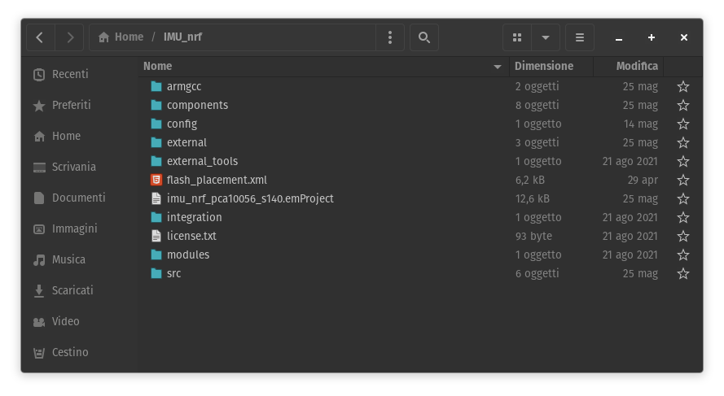

---

## Codice custom (`src/`)

1. **`src/main.c`**: File principale contenente la funzione `main()`.
2. **`src/global_defs.h`**: Header file che definisce costanti, macro e variabili globali accessibili dall'intero applicativo.
3. **`src/ble/`**: Moduli dedicati all'inizializzazione dello stack BLE, alla configurazione dei servizi GATT e alla gestione degli eventi Bluetooth.
4. **`src/board_config/`**: File per l'inizializzazione e la mappatura dell'hardware fisico (es. definizione dei pin, configurazione delle interfacce I2C/SPI).
5. **`src/sensors/`**: Moduli dedicati all'inizializzazione e alla lettura dei sensori (accelerometro, giroscopio, magnetometro).

  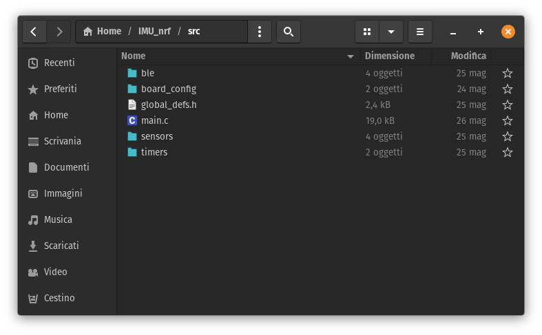

6. **`src/timers/`**: Moduli per l'istanza e la gestione degli Application Timer, utilizzati per schedulare task periodici o ritardati in modo non bloccante.

---

## Compilazione del progetto

Per avviare la compilazione del progetto si può premere il tasto `F7` oppure dalla barra dei menu selezionare `Build` -> `Build 'imu_nrf_pca10056_s140'`.

  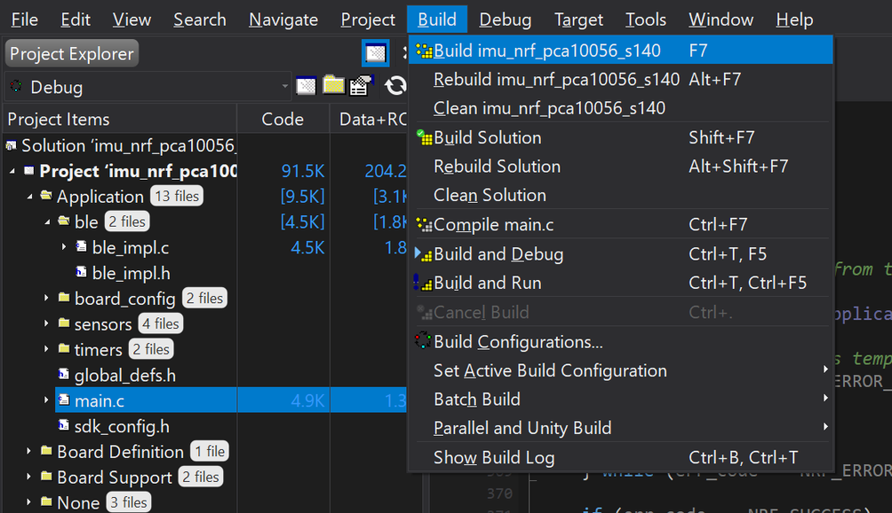

Si può cambiare configurazione di compilazione (Debug o Release) dal menù a tendina.

  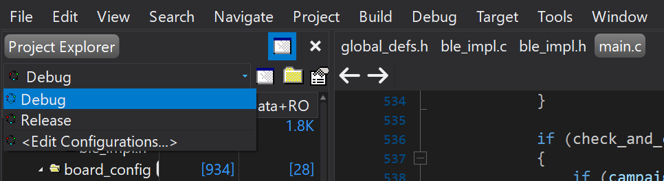

---

> [!NOTE]
> I seguenti passaggi servono solo durante lo sviluppo del progetto per aggiungere ulteriori file o librerie. Il file progetto di Segger originale è già pronto all'utilizzo.

## Aggiunta di un file sorgente al progetto

1. Nel `Project Explorer`, fare clic destro sul nodo del progetto e selezionare `"Add Existing File..."`.

  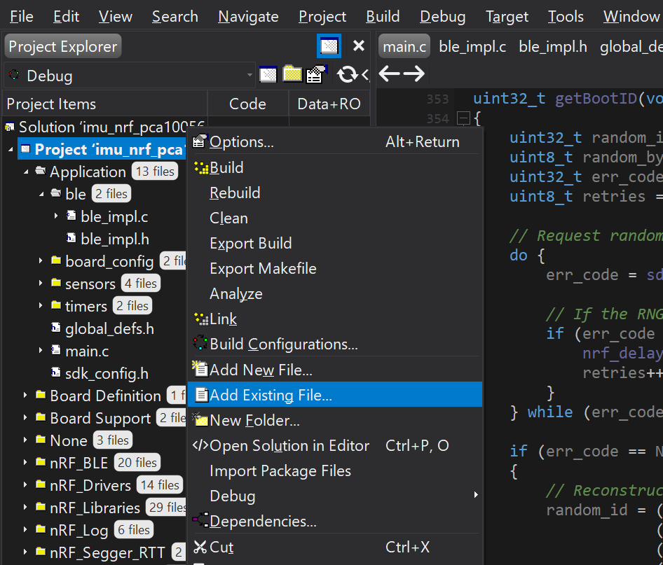

2. Selezionare il file desiderato per includerlo nell'albero di progetto.

---

## Configurazione dei percorsi di inclusione (Include Directories)

Per permettere al compilatore di risolvere le dipendenze dei file header (`.h`) appena aggiunti, è necessario indicare il percorso della loro directory:

1. Andare sulla barra dei menu in `Project` -> `Options...`.

  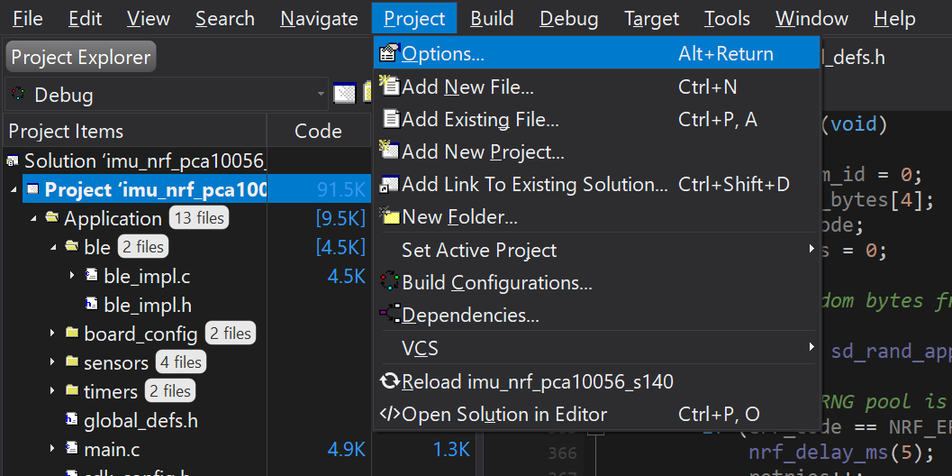

2. Impostare il menu a tendina della configurazione (in alto a sinistra) su `Common` (Questa non è una vera e propria configurazione ma è un modo comodo per modificare le impostazioni di tutte le configurazioni).

  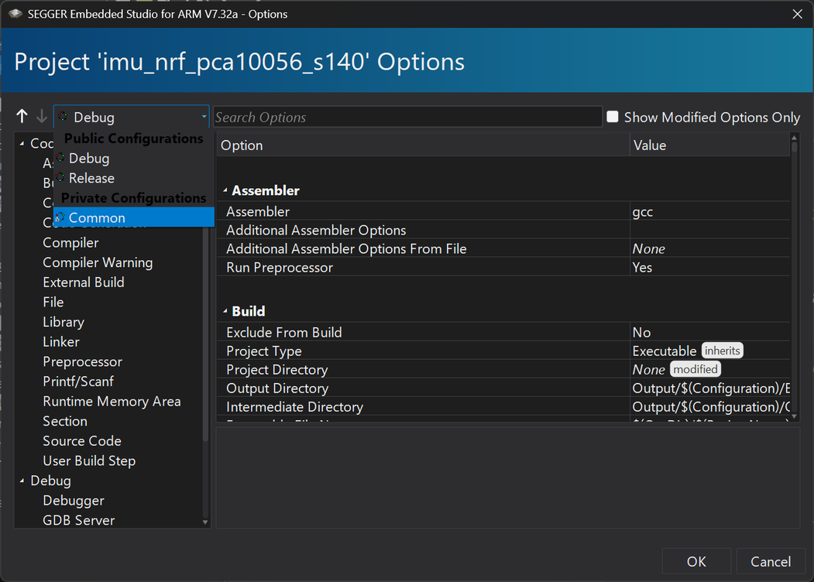

3. Selezionare `Preprocessor` e fare doppio click su `User Include Directories`.

  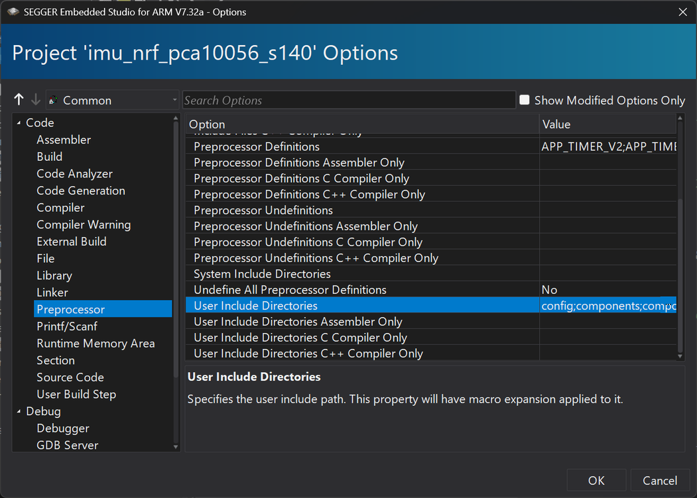

4. Aggiungere il percorso della cartella contenente i file `.h`, il percorso deve partire sempre da `src/nome_cartella`. È necessario assicurarsi che siano già presenti le directory relative al progetto descritte precedentemente, sono quelle evidenziate nella seguente immagine:

  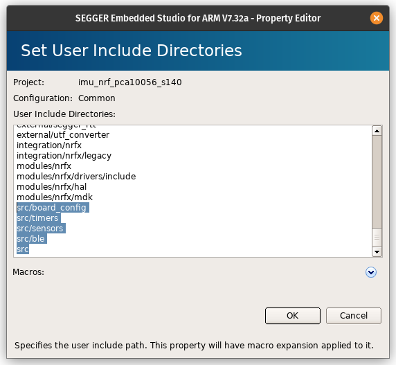

---

## Abilitazione dei moduli dell'SDK (`sdk_config.h`)

Se i file aggiunti appartengono a un modulo ufficiale del Nordic nRF SDK (e non a codice custom), il modulo deve essere esplicitamente abilitato.

1. Aprire il file `sdk_config.h`.
2. Cercare la macro di configurazione relativa al modulo (tipicamente nel formato `[NOME_MODULO]_ENABLED`).
3. Modificare il valore della macro da `0` a `1` per attivare la compilazione del sorgente.

Di seguito si elencano le macro principali che sono state impostate a `1` per il progetto `IMU_nrf`:

* **Moduli Bluetooth e SoftDevice:**
    * `NRF_SDH_ENABLED` `1` e `NRF_SDH_BLE_ENABLED` `1` (Inizializzazione del SoftDevice e dello stack BLE)
    * `BLE_ADVERTISING_ENABLED` `1` (Advertising BLE)
    * `NRF_BLE_GATT_ENABLED` `1` (Protocollo GATT)
    * `PEER_MANAGER_ENABLED` `1` (Gestione del pairing e sicurezza dei dispositivi)
    * `BLE_BAS_ENABLED` `1` (Servizio BLE per il livello di batteria)
* **Driver Periferiche Hardware (Sensori e I/O):**
    * `NRFX_TWI_ENABLED` `1` e `TWI_ENABLED` `1` (Abilitazione del bus I2C per i sensori)
    * `NRFX_SAADC_ENABLED` `1` e `SAADC_ENABLED` `1` (Abilitazione dell'ADC per la lettura analogica)
    * `NRFX_GPIOTE_ENABLED` `1` e `GPIOTE_ENABLED` `1` (Gestione hardware degli interrupt sui pin)
    * `NRFX_UART_ENABLED` `1` e `UART_ENABLED` `1` (Comunicazione seriale standard)
* **Librerie di Sistema:**
    * `APP_TIMER_ENABLED` `1` (Gestione dei timer di sistema)
    * `NRF_PWR_MGMT_ENABLED` `1` (Gestione del risparmio energetico)
* **Logging e Debugging:**
    * `NRF_LOG_ENABLED` `1` (Modulo principale per il logging)
    * `NRF_LOG_BACKEND_RTT_ENABLED` `1` (Visualizzazione dei log in tempo reale tramite Segger RTT)
    * `NRF_LOG_BACKEND_UART_ENABLED` `1` (Visualizzazione dei log tramite terminale Seriale)

---

## Programmazione della scheda

Prima di scrivere il codice sulla scheda è necessario averlo compilato senza errori.

Step da seguire:

1. Spegnere entrambe le schede (con i loro switch).
2. Collegare il DK al sensore per poter programmare l'nRF52840. Per farlo bisogna seguire questo schema:

| PIN DK | PIN scheda sensore |
| :--- | :--- |
| **GND** | **G** |
| **SWDIO** | **D** |
| **SWCLK** | **C** |

Bisogna poi collegare i pin `VDD` e `VTG` del DK per metterlo in modalità programmazione scheda esterna.
    

  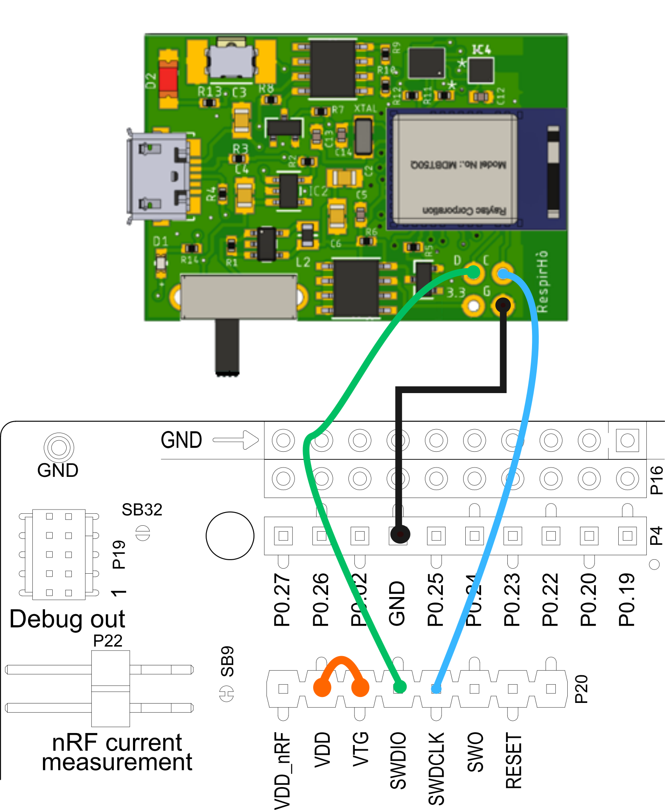

> [!WARNING]
> NOTA: il sensore deve essere alimentato con la sua batteria o tramite la sua porta USB. Non bisogna alimentare il sensore tramite il DK mentre è già alimentato con la batteria/porta usb perché potrebbe bruciarsi.

3. Collegare il DK al computer e accendere entrambe le schede.
4. Per verificare che il DK sia entrato nella modalità programmazione esterna e che il collegamento funzioni, bisogna aprire il menù a tendina `Target` e cliccare sul bottone `Connect J-Link`

  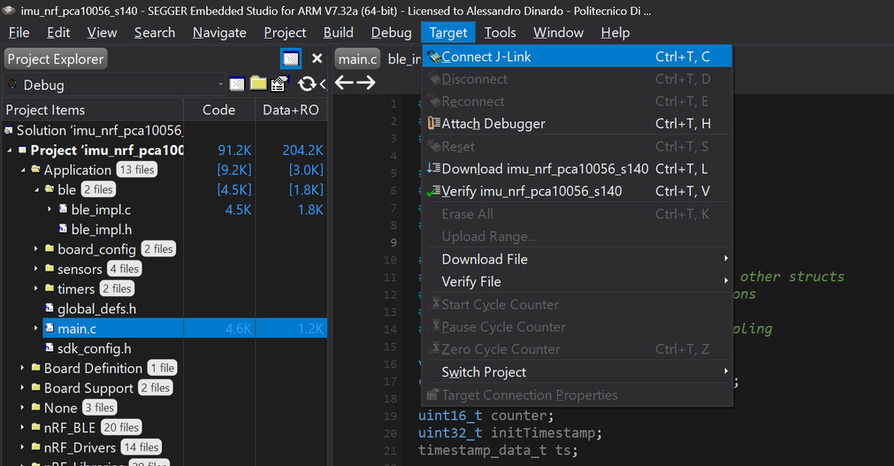

> [!TIP]
> Se appare il messaggio di successo "<code style="color : green;">Connected target interface J-Link</code>" allora tutto funziona correttamente. Altrimenti se appare l'errore "<code style="color : red">Failed to connect to target</code>" molto probabilmente una delle due schede è spenta, la batteria del sensore è scarica oppure i cavi collegati al sensore non fanno buon contatto.

  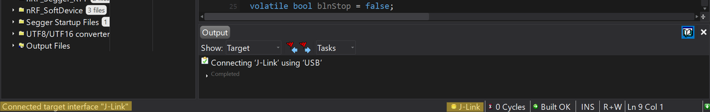

5. Per scrivere il codice sull'nRF52840, bisogna premere il pulsante `Download imu_nrf_pca10056_s140` nel menù a tendina `Target`. Durante questa fase è essenziale assicurarsi che i cavi inseriti nel sensore facciano contatto, quindi vanno tenuti leggermente premuti.

  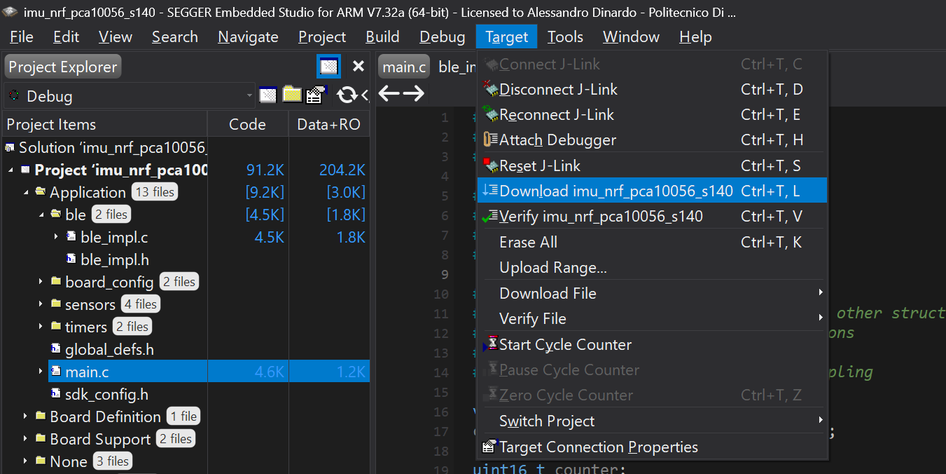

Dopo che Segger ha finito di scrivere il codice, `J-Link` dovrebbe disconnettersi.

> [!CAUTION]
> Se durante la procedura appare l'errore "<code style="color : red">Failed to download application. Generic error. Please check J-Link and target connection.</code>" è probabile che un cavo si sia disconnesso, oppure che la batteria si sia scaricata e il sensore si sia quindi spento.

6. Per verificare che il codice sia stato scritto correttamente e iniziare il debug, si può premere la freccia di `Start Execution`.

  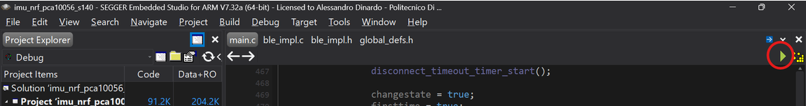

